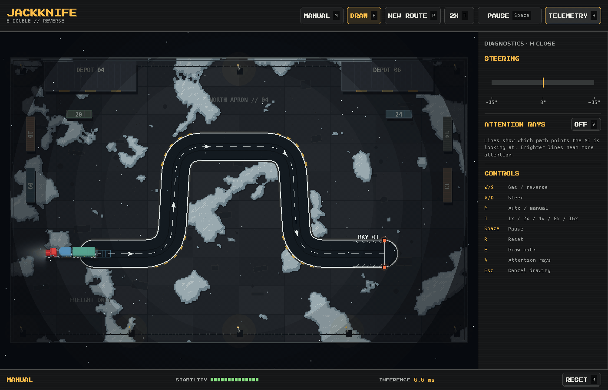

## Quick Start

This repository uses [`uv`](https://docs.astral.sh/uv/) for fast, reproducible
dependency management and execution.

If you do not have `uv` installed:

```bash
curl -LsSf https://astral.sh/uv/install.sh | sh
```

Install Dependencies

```bash
uv sync
```

Run the simulation in autonomous mode (loads `models/pfn_best.pt` by default):

```bash
uv run python main.py
```

Train the Transformer policy using the streaming synthetic data pipeline:

```bash
uv run python main.py --train --epochs 100 --batch-size 64 --lr 3e-4 --stream
```
